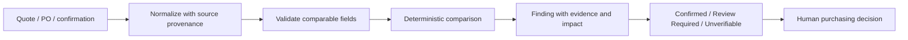

# B2B Procurement Discrepancy Benchmark
**Amy V · Full-Stack & AI Systems Engineering**

An evidence-oriented architecture for comparing quotations, purchase orders and confirmations. The private-build release record documents **60/60 synthetic pairs matched, 20/20 expected critical findings matched and zero unsupported critical findings**. This is exact agreement on critical findings, not a measured AI extraction-accuracy claim.

## Comparison policy
Preserve currency and units. Missing values remain unknown. Different currencies require review rather than implicit conversion. Compare decimal amounts with explicit tolerances. Keep delivery dates, incoterms, freight and exclusions as separate findings instead of rolling them into an unexplained risk score.

Every finding identifies document, section, field, observed values and the limits of financial-impact calculation. This public utility demonstrates unit-price and date tolerance comparisons only; it does not reproduce the private extraction or procurement engine.

## Run and review
`python -m unittest -v`

Start with `module.py`, then inspect [the historical benchmark summary](benchmarks/synthetic-60-pair-summary.json) and [verification ledger](docs/verification-ledger.md). The historical 60-pair corpus is not bundled; local public tests are independently named and counted.

## Commercial boundaries
No purchasing authority, supplier contact, financial commitment, exchange-rate service or document upload exists here. Caller policy must determine tolerances and approve downstream actions. See [publication boundary](docs/publication-boundary.md).
